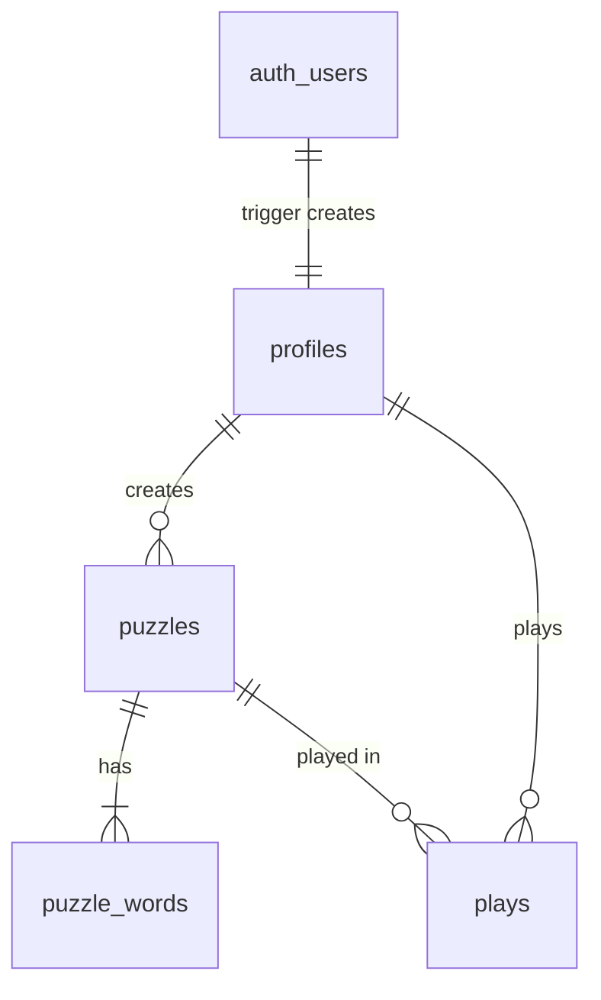

# SCHEMA: FC-Bootcamp

- **`portfolio/`** has no database. Its content is static and lives in the app's source.
- **`clone/`** (the Cadgy clone, PRD §4.4) uses Supabase Postgres and Auth. It has no Storage. It has four tables, the bootcamp's cap.

## Entity overview

- A **puzzle** is a grid of tile columns plus its word list. A puzzle with a `daily_date` is a daily, which only editors can make. One without a date is a community puzzle.
- A **play** is one player's progress on one puzzle. Scores, leaderboards and personal stats are all worked out from `plays`. Nothing is stored twice.

## Tables

### `profiles`

One row per auth user, created by the `on_auth_user_created` trigger, never by the app.

| Column | Type | Null | Notes |
|---|---|---|---|
| `id` | uuid | no | PK, → `auth.users.id`, cascade on delete |
| `username` | text | no | Unique. Taken from the sign-up metadata `username`. Guests get `guest-xxxxxx`. |
| `is_editor` | boolean | no | Default false. Ben sets his own to true in the Table Editor. No policy lets the app change it. |
| `is_guest` | boolean | no | Default false. Copied from `auth.users.is_anonymous`, so it's true for "Play as guest" accounts. |
| `created_at` | timestamptz | no | Default `now()` |

### `puzzles`

| Column | Type | Null | Notes |
|---|---|---|---|
| `id` | uuid | no | PK, `gen_random_uuid()` |
| `creator_id` | uuid | no | → `profiles.id`, default `auth.uid()` |
| `title` | text | yes | Optional |
| `columns` | jsonb | no | An array of columns, and each column is an array of tile strings, e.g. `[["E","S","U","MA"],["T","S","N",""],…]`. Tiles are uppercase with 0–3 letters, and `""` is a blank tile (❤️). |
| `daily_date` | date | yes | Unique. Null means a community puzzle. "Today" is UTC+8. |
| `created_at` | timestamptz | no | Default `now()` |

### `puzzle_words`

| Column | Type | Null | Notes |
|---|---|---|---|
| `id` | uuid | no | PK |
| `puzzle_id` | uuid | no | → `puzzles.id`, cascade on delete |
| `word` | text | no | Uppercase. Unique per puzzle. Whether it can be built from the grid is checked by the app (`lib/grid.ts`), not the database. |
| `kind` | text | no | `'basic'` or `'bonus'` |
| `clue` | text | yes | Required when `kind = 'bonus'` (check constraint) |

### `plays`

| Column | Type | Null | Notes |
|---|---|---|---|
| `id` | uuid | no | PK |
| `user_id` | uuid | no | → `profiles.id`, default `auth.uid()` |
| `puzzle_id` | uuid | no | → `puzzles.id`, cascade on delete |
| `found` | text[] | no | Default `{}`. The words found, in the order they were found. The score is 10 × its length. |
| `invalid_count` | int | no | Default 0 |
| `started_at` | timestamptz | no | Default `now()`. The timer starts here. |
| `finished_at` | timestamptz | yes | Set when every word is found |

Unique on (`user_id`, `puzzle_id`): one play per player per puzzle.

## Functions

- `handle_new_user()` (trigger, `security definer`): inserts the `profiles` row on sign-up, which covers the bootcamp's "signed in, but no profile" trap.
- `create_puzzle(p_title, p_columns, p_daily_date, p_words)` (`security invoker`, so RLS applies): inserts the puzzle and its words in one transaction and returns the new id. A puzzle never exists without its words.
- `seed_guest()`: added in build step FR-12. It gives the calling guest a few past plays so the demo account isn't empty.

## Off-store state

| What | Where | Notes |
|---|---|---|
| Supabase URL and publishable key | `clone/.env.local` (gitignored) **and** the clone's Vercel env vars | `NEXT_PUBLIC_SUPABASE_URL`, `NEXT_PUBLIC_SUPABASE_PUBLISHABLE_KEY`. Ben enters them in both places. No secret key is used anywhere. |
| Vercel projects | Two projects from this repo, with Root Directory `portfolio` and Root Directory `clone` | The URLs are recorded in `CLAUDE.md` §1 |
| Supabase Auth settings | Dashboard → Authentication | **Confirm email: off** (FR-8). **Allow anonymous sign-ins: on**, from FR-12. |
| Editor flag | `profiles.is_editor` on Ben's own row | Set by hand in the Table Editor, which bypasses RLS |
| Demo login | Supabase anonymous users plus `seed_guest()` | Each click gets a fresh guest, so a stranger can't wipe anyone else's demo |

## Access control (Row Level Security)

Every table has RLS enabled, with its policies in the same migration.

| Table | select | insert | update | delete |
|---|---|---|---|---|
| `profiles` | everyone | none (the trigger inserts) | none | none |
| `puzzles` | your own, or any puzzle whose creator isn't a guest | as yourself, and `daily_date` must be null unless your profile `is_editor` | none | none |
| `puzzle_words` | when the parent puzzle is readable | only into a puzzle you created | none | none |
| `plays` | any signed-in user (for the leaderboard) | your own (`user_id = auth.uid()`) | your own | none |

Consequences worth knowing:
- No one can edit or delete anyone's puzzle, including their own. Editing is on the cut list.
- A guest's puzzles are visible only to that guest, so the public lists stay clean.
- Word lists are readable by any signed-in user, so the answers reach the browser. This is accepted, and the real Cadgy does the same.

## Migrations

SQL files live in `clone/supabase/migrations/NNNN_name.sql`, in order. Ben applies each one by pasting it into the Supabase SQL Editor. There's no Supabase CLI, which keeps the stack to four tools. Once a migration has been applied, it's append-only: to change it, write a new one that corrects it.

## Keeping this true

This file describes what exists. When it disagrees with the migrations, the migrations are right and this file is stale.
